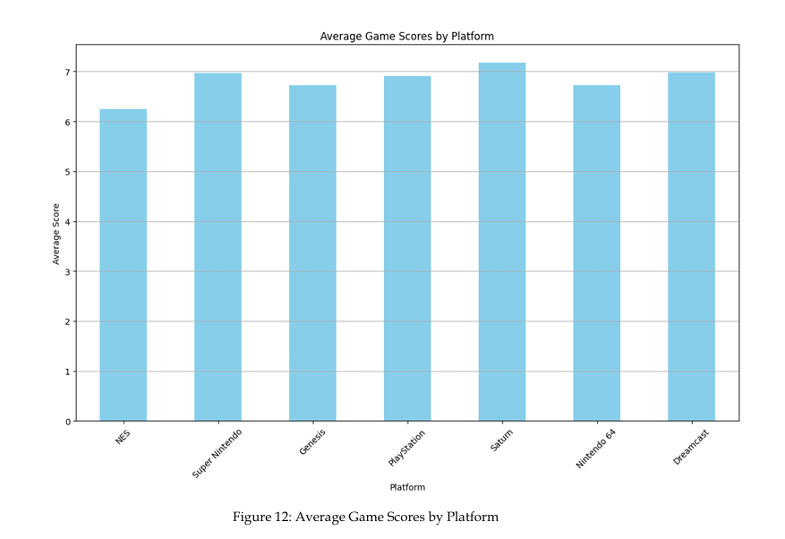

# EGM in the 1990s: Editorials and Game Reviews Analysis

Analysis of *Electronic Gaming Monthly* (EGM), 1990–1999: how a leading game magazine talked about the industry, and how its reviewers scored games and platforms during the shift from 2D to 3D. Built for my master's thesis, *The Evolution of Gaming Aesthetics and Community in the 1990s as Reflected in Electronic Gaming Monthly* (MA Communication & Information Studies, University of Groningen).

This repository contains the analysis code. Findings are discussed in the thesis.

> **The data is not included.** The magazine content is copyrighted. The editorials and review data were provided for this research by EGM's editor-in-chief, so I cannot redistribute them. The `data/` folder is git-ignored.

## What it does

- **Editorials:** word frequencies, LDA topic modeling, topic distributions over time, and sentiment trends.
- **Game reviews:** parses review listings into a structured table of reviewer scores, then analyzes average scores by year and platform, high-scoring games, and the top-rated game of each year.

## Key findings

- **Editorial topics tracked the hardware cycle.** LDA topic modeling separated editorials about the early-1990s console generation (Super Nintendo, Genesis) from those about the 1994 Sony/Sega transition (PlayStation, Saturn).
- **Technology coverage was cautious.** Console and technology topics scored low on sentiment, meaning EGM covered them in a more neutral tone, while big-name games such as The Legend of Zelda and GoldenEye scored among the highest.
- **More releases did not mean higher scores.** 1994 and 1999 had the most releases but below-peak average scores; only 1996 and 1997 averaged above 7.
- **The market leader was not the top-rated platform.** Sega Saturn was the only platform among the three major manufacturers to average above 7 over the decade, while PlayStation ranked fourth despite releasing over twice as many games as its competitors.
- **PlayStation led in high-scoring games.** 37 of the 107 games scored above 9 were on PlayStation, a 6.2% rate on its 588 releases.


## Data

The corpus covers all editorials and game reviews from 120 EGM issues (1990–1999). The code expects these files in `data/` (not included):

- `17-125.txt`: review listings (game, platform, reviewer scores), by issue
- `editor.csv`: editorial text with year and month

## Notebooks

Run them in numbered order.

| Notebook | What it does |
|---|---|
| `01_parse_reviews.ipynb` | Splits the review text by issue and extracts reviewer scores into a table |
| `02_review_ratings_analysis.ipynb` | Average scores by game, year and platform; platform release counts; high-scoring games; top-rated game per year |
| `03_editorial_topics_sentiment.ipynb` | Tokenization, stopword removal, word frequencies, LDA topic modeling (tomotopy), topic-by-year heatmaps, TextBlob sentiment by topic |
| `04_editorial_sentiment_trends.ipynb` | Sentiment trends by year and month, word frequency trends by year |

`results/word_frequencies.csv` holds aggregate word counts only, with no original text.

## Tech

Python, pandas, NLTK, TextBlob, tomotopy, little-mallet-wrapper, matplotlib, seaborn, pyLDAvis.

## How to run

```bash
pip install jupyter pandas nltk textblob tomotopy little-mallet-wrapper matplotlib seaborn pyLDAvis
python -c "import nltk; nltk.download('punkt'); nltk.download('stopwords')"
jupyter notebook
```

Place your own data files in `data/` first, then open the notebooks in order.

## Limitations

- TextBlob uses a general-purpose lexicon that is not tuned to 1990s game journalism, so polarity scores are rough indicators.
- The number of topics and the topic interpretations are judgment calls, not ground truth.
- Review scores come from a small, stable group of reviewers and do not represent the whole gaming community.
- One US magazine, subjective editorials: the results describe EGM's coverage, not causal effects.
- Early attempts to read scanned magazine pages with OCR were abandoned because the output was unreadable. The final analysis uses the text and data provided by the magazine.
